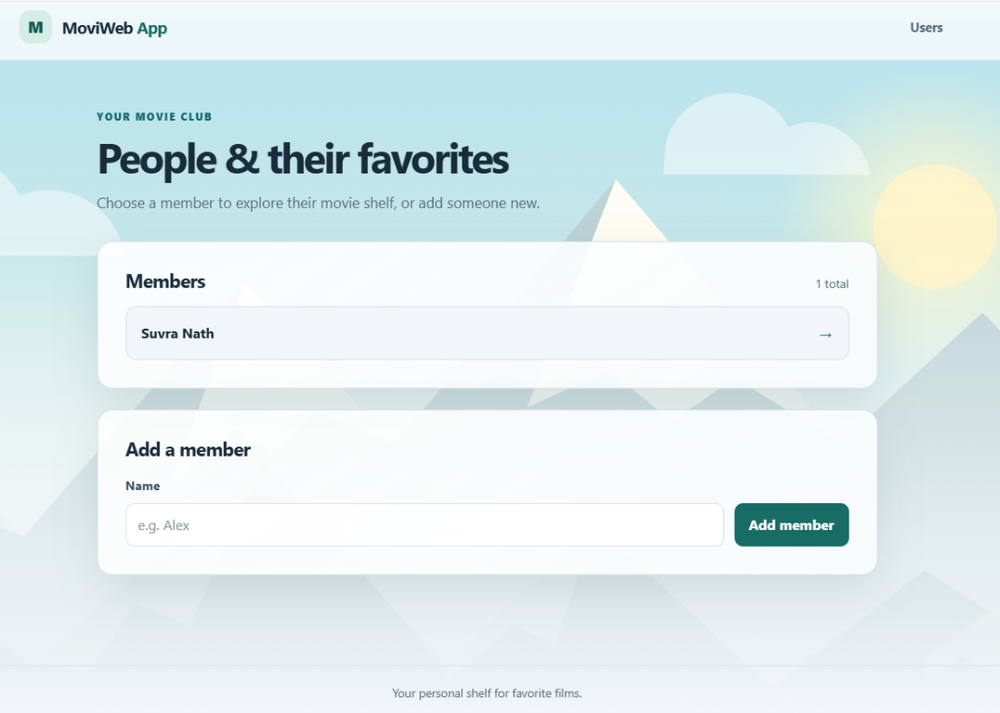
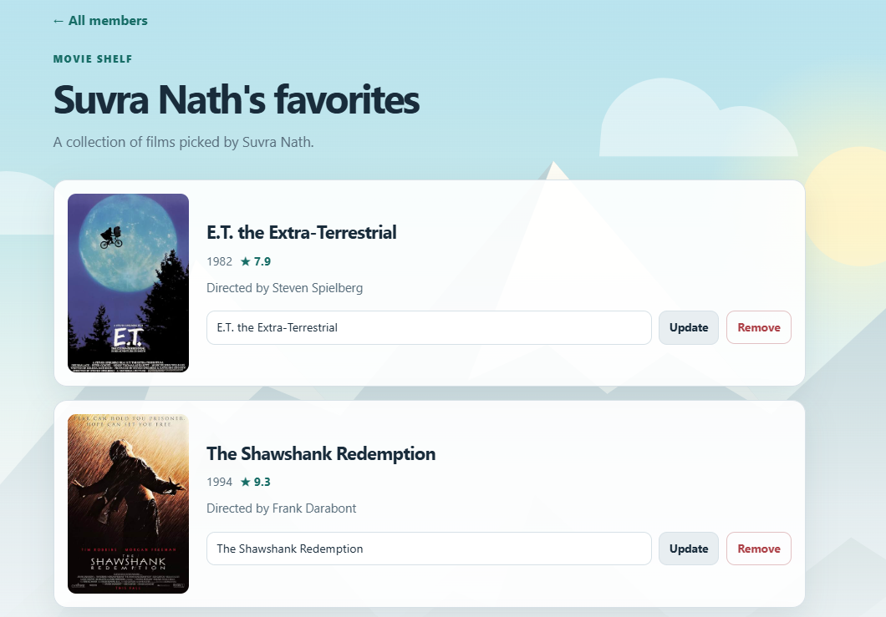

# MoviWeb App

A movie-favorites manager where members can build and manage personal film collections, complete with movie details and posters from OMDb.

## Live app

**[Visit suvranath.pythonanywhere.com](https://suvranath.pythonanywhere.com)**

Hosted on PythonAnywhere’s free tier.

## Demo

| Members | Favorite movies |
|:--:|:--:|
|  |  |

## Tech stack

- **Python** and **Flask** — application and routes
- **Flask-SQLAlchemy** with **SQLite** — database and persistence
- **Jinja2**, **HTML**, and **CSS** — responsive templates and styling
- **OMDb API** — movie information and posters
- **PythonAnywhere** — hosting

